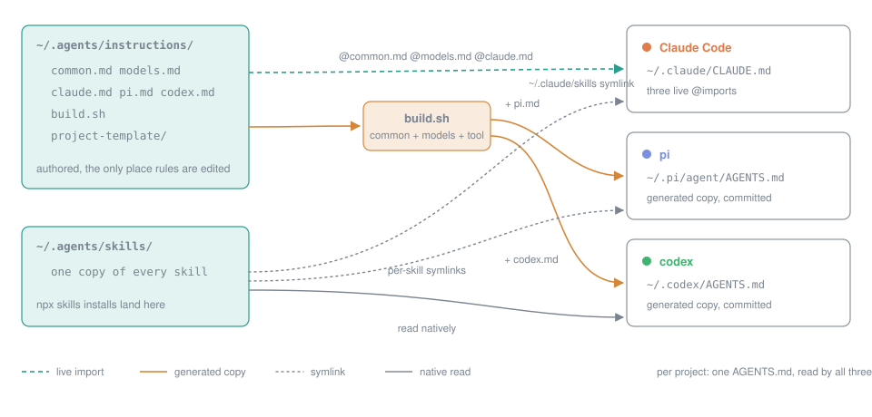

# agent-dotfiles

Claude Code, pi and codex read the same rules, the same model roster and the same skills on this machine, from one directory, with nothing maintained twice.



Claude Code is the only harness with an import syntax, so it reads the source live. pi and codex have none, so a six-line script renders their files, with a GENERATED header, and the copies are committed so every rebuild is a reviewable diff. Those two copies are the only duplicated bytes in the setup.

## What to review

Five files hold every rule, all in `agents/.agents/instructions/`:

| File | Who reads it |
|---|---|
| `common.md` | every harness, every repo |
| `models.md` | every harness: task to model family, with one fallback each |
| `claude.md` | Claude Code only |
| `pi.md` | pi only |
| `codex.md` | codex only |

Everything else is derived from these or is mechanics. Two things carry procedure or enforcement rather than rules: the `orchestrate` skill (tmux launch recipes, brief template, per-slice loop) and `claude/.claude/hooks/no-worktree.sh`.

The roster names model families, not versions. Each harness runs the latest version of the family it offers, so version bumps need no edit.

## Layout

```
agents/.agents/
  instructions/        the five files above, build.sh, project-template/
  skills/              every shared skill, one copy each
  .skill-lock.json     written by npx skills
claude/.claude/
  CLAUDE.md            three @imports: common, models, claude
  agents/              user-level agent definitions
  hooks/               no-worktree.sh, wired from ~/.claude/settings.json
  statusline.sh        status line, wired from ~/.claude/settings.json
pi/.pi/agent/AGENTS.md    GENERATED: common + models + pi
codex/.codex/AGENTS.md    GENERATED: common + models + codex
install.sh               render, stow, link skills
```

## How each harness loads it

| | Claude Code | pi | codex |
|---|---|---|---|
| Global rules | `~/.claude/CLAUDE.md`, three live imports | generated copy | generated copy |
| Skills | `~/.claude/skills` is a symlink to the shared tree | per-skill relative symlinks | reads `~/.agents/skills` natively |
| Project rules | `AGENTS.md`, read directly when no `CLAUDE.md` exists | `AGENTS.md`, first match in the directory | `AGENTS.md`, repo root down to cwd |

Global loads first, project last. The more specific file wins on conflict.

## Workflow

1. Edit a file under `agents/.agents/instructions/`, or add a skill under `agents/.agents/skills/`.
2. Run `./install.sh`. It renders the generated files, stows the four packages into `$HOME`, points `~/.claude/skills` at the shared tree and adds any missing pi skill links. Safe to re-run.
3. Commit. Conventional Commits, one logical change per commit.

A new rule goes in the lowest layer that covers everyone who needs it: `common.md` for all harnesses, a tool file only when it names that tool's own feature, the project's `AGENTS.md` for repo facts. Procedures go in a skill, not an instruction file.

## Per project

One `AGENTS.md`, read by all three harnesses. Start from `agents/.agents/instructions/project-template/`. Add a `CLAUDE.md` shim (`@AGENTS.md` plus a Claude-only section) only when the repo has a Claude-specific rule, because any `CLAUDE.md` or `CLAUDE.local.md` above the working directory switches Claude Code to CLAUDE.md-only mode.

## Not in this repo

- `~/.claude/settings.json`: permissions, plugins, hook and status line wiring, model defaults. Machine state.
- pi and codex settings and permission rules.
- `agents/.agents/skills/synced/`: Claude Code's cloud-synced skills land there through the symlink; git-ignored.

## New machine

```
brew install stow
git clone git@github.com:snehalyelmati/agent-dotfiles.git ~/Documents/agent-dotfiles
cd ~/Documents/agent-dotfiles && ./install.sh
```

Then add two entries to `~/.claude/settings.json`: a `PreToolUse` hook for `~/.claude/hooks/no-worktree.sh`, and a `statusLine` of type `command` running `~/.claude/statusline.sh`. The status line needs `jq`.

## License

MIT for everything original. Third-party skills under `agents/.agents/skills/` keep their upstream licenses, listed in `THIRD_PARTY.md`.
