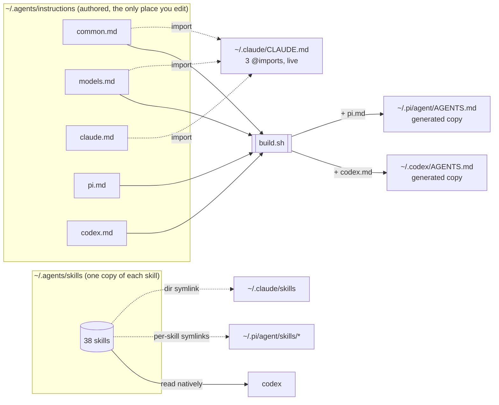
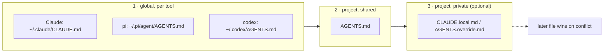

# agent-dotfiles

One source of truth for the instructions, model roster and skills that Claude Code, pi and codex read on this machine. Managed with GNU stow.

## Layout

```
agents/.agents/
  instructions/
    common.md            rules for every harness in every repo
    models.md            task-to-model roster shared by every harness
    claude.md            Claude Code only: agents, artifacts
    pi.md                pi only: delegate mechanics, grilling
    codex.md             codex only: subagent mechanics
    build.sh             renders the pi and codex files below
    project-template/    AGENTS.md skeleton for new repos
  skills/                every shared skill, one copy each
  .skill-lock.json       written by npx skills
claude/.claude/
  CLAUDE.md              three @imports: common, models, claude
  agents/                user-level agent definitions (opus-explorer)
  hooks/                 no-worktree.sh, wired from ~/.claude/settings.json
pi/.pi/agent/AGENTS.md   GENERATED: common + models + pi
codex/.codex/AGENTS.md   GENERATED: common + models + codex
install.sh               render, stow, link skills
```

## How it fits together





## How each harness reads it

| Layer | Claude Code | pi | codex |
|---|---|---|---|
| Global | `~/.claude/CLAUDE.md` imports the three source files live | `~/.pi/agent/AGENTS.md`, generated copy | `~/.codex/AGENTS.md`, generated copy |
| Skills | `~/.claude/skills` is a symlink to `~/.agents/skills` | `~/.pi/agent/skills/<name>` are per-skill relative symlinks into `~/.agents/skills` | reads `~/.agents/skills` natively |
| Project | `AGENTS.md` read directly when no `CLAUDE.md` exists | `AGENTS.md`, first match in the directory | `AGENTS.md`, repo root down to cwd |

Load order is global first, project last; the more specific file wins on conflict.

Claude Code is the only harness with an import syntax, so pi and codex get rendered copies. The copies carry a GENERATED header and are committed, so every rebuild is a reviewable diff. Nothing else is duplicated.

## Workflow

1. Edit under `agents/.agents/instructions/` or add a skill under `agents/.agents/skills/`.
2. Run `./install.sh`. It renders the generated files, stows the four packages into `$HOME`, points `~/.claude/skills` at the shared tree and adds any missing pi skill links. Safe to re-run.
3. Commit. Conventional Commits, one logical change per commit.

A new rule goes in the lowest layer that covers everyone who needs it: `common.md` for all harnesses, a tool file only when it names that tool's own feature, the project's `AGENTS.md` for repo facts. Procedures go in a skill, not an instruction file.

## Per project

A single `AGENTS.md` is read by all three harnesses. Start from `project-template/`. Add a `CLAUDE.md` shim (`@AGENTS.md` plus a Claude-only section) only when the repo has a Claude-specific rule; a `CLAUDE.md` or `CLAUDE.local.md` anywhere above the working directory switches Claude Code to CLAUDE.md-only mode.

## Not in this repo

- `~/.claude/settings.json`: permissions, plugins, hook wiring, model defaults. Machine state.
- pi and codex settings and permission rules.
- `agents/.agents/skills/synced/`: Claude Code's cloud-synced skills land there through the symlink; git-ignored.

## New machine

```
brew install stow
git clone <this repo> ~/Documents/agent-dotfiles
cd ~/Documents/agent-dotfiles && ./install.sh
```

Then add the `PreToolUse` hook entry for `~/.claude/hooks/no-worktree.sh` to `~/.claude/settings.json`.

## License

MIT for everything original. Third-party skills under `agents/.agents/skills/` keep their upstream licenses, listed in `THIRD_PARTY.md`.
